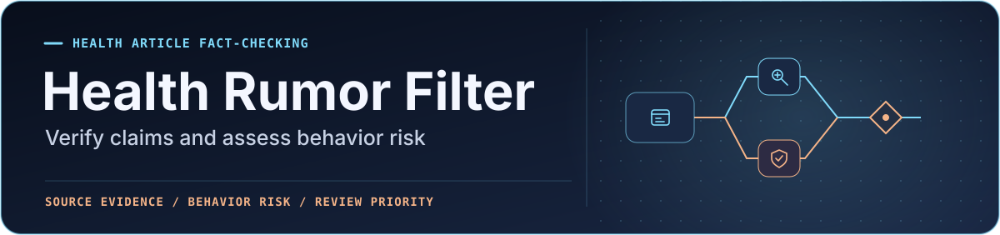
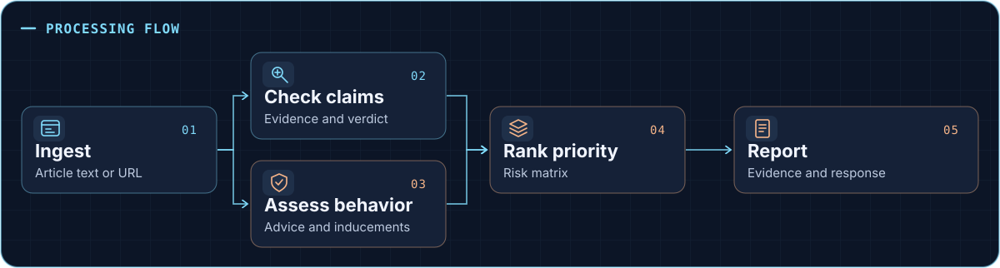

<p align="center">
  
</p>

# 家庭群健康谣言双滤网核查系统

核查健康养生文章中的核心主张，识别停药、消费导流等行为风险，再结合两个结果给出家庭群的处置优先级。项目面向第九届全国大学生数字编辑创新大赛赛道七。

## 冻结测试集结果

```text
81 条冻结测试样本，单模型与完整系统各运行一次

                         单模型        完整系统
尽快劝阻召回              0 / 11       10 / 11
处置档位准确率              72.8%         87.7%
认知准确率                  75.3%         79.0%
平均耗时                     1.0s         10.5s
```

完整系统在处置优先级上找到了 11 条高优先级内容中的 10 条。认知准确率相差 3.7 个百分点，McNemar 精确检验 `p = 0.45`。以上摘自比赛正式评测，行为面标签使用 Claude 辅助标注，双人一致性尚未检验。[评测口径与局限](docs/评测摘要.md)

## 架构



认知面以冻结的本地知识库为主，融合 BM25 与向量候选后重排。行为面识别医疗行为建议、消费导流等风险。两路结果进入风险矩阵，输出「尽快劝阻」「提醒留意」「告知误区」或「无需处理」。[微信小程序说明](app/README.md)

## 快速开始

使用 Python 3.12。从仓库根目录安装依赖，复制随附的合成题到评测入口，再用假模型检查指标。此流程无需模型密钥。

```bash
python -m venv .venv
source .venv/bin/activate
python -m pip install -r requirements.txt -r app/api/requirements.txt
cp data/splits/synthetic_dev.jsonl data/splits/dev.jsonl
cp data/splits/synthetic_test.jsonl data/splits/test.jsonl
python -m pytest
python eval/eval.py --config full --split dev --model stub:oracle --no-store
```

Windows PowerShell 使用 `.venv\Scripts\Activate.ps1` 激活虚拟环境。 `stub:oracle` 返回标签，用于检查指标计算。

## CLI 速查

| 命令 | 用途 |
| --- | --- |
| `python eval/eval.py --config baseline --split dev --model stub:fixed --no-store` | 用固定答案检查认知面基线 |
| `python eval/eval.py --config all --split dev --model stub:oracle --no-store` | 验证消融配置和指标计算 |
| `python eval/eval.py --config full --split dev --model real` | 用已配置的模型和检索服务跑开发集 |
| `python scripts/build_kb.py --snapshot-only` | 查看本地知识库快照 |
| `python scripts/check_retrieve.py` | 联网检查权威来源检索 |

<details>
<summary>检索、数据与目录</summary>

复制 [`.env.example`](.env.example) 到 `.env` 并按模板配置模型和检索密钥。[`config.yaml`](config.yaml) 管理模型、检索通道和评测配置。每条证据记录来源通道。重排失败时退回初检顺序，并在追踪记录中标记降级。

| 路径 | 内容 |
| --- | --- |
| [`src/cognitive/`](src/cognitive/)、[`src/kb/`](src/kb/) | 主张核查、权威来源检索和本地知识库 |
| [`src/behavior/`](src/behavior/)、[`src/risk_matrix.py`](src/risk_matrix.py) | 行为风险识别和处置矩阵 |
| [`eval/`](eval/)、[`tests/`](tests/) | 评测入口、指标与测试 |
| [`docs/annotation_guide.md`](docs/annotation_guide.md) | 行为面标注口径 |
| [`app/`](app/) | 演示应用与部署入口 |

仓库提供的是用于验证管线的合成样例。开篇的正式评测来自比赛使用的冻结测试集。运行真实模型还需要按配置准备知识库。面向家庭群的核查报告附证据来源，涉及具体用药时提示读者遵医嘱。

</details>
